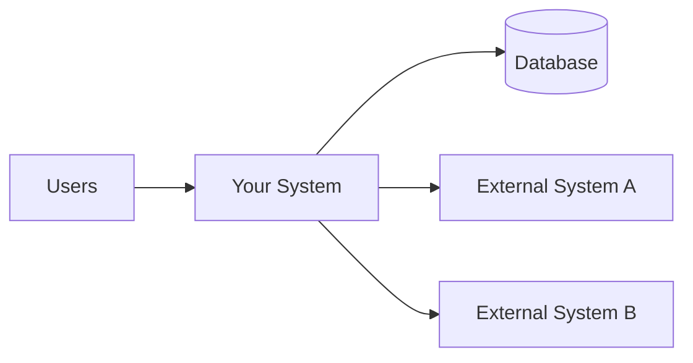

<!--
  Document   : Software Requirements Specification (SRS) Template
  Author     : Athulya Peshali
  Role       : Business Analyst
  Standards  : IEEE 830-1998 / ISO/IEC/IEEE 29148:2018
  Copyright  : (c) 2026 Athulya Peshali. All rights reserved.
  Notice     : Prepared for portfolio verification. Not for unauthorised
               distribution or reproduction.

Software Requirements Specification
`[Project Name]`
Aligned with IEEE 830-1998 and ISO/IEC/IEEE 29148:2018

---
> **© 2026 Athulya Peshali. All rights reserved.**
> Authored by **Athulya Peshali** (Business Analyst).
> Prepared for portfolio verification. **Not for unauthorised distribution or reproduction.**
> This template contains no confidential client or employer information. All project names, data and requirements shown are fictional examples.
Document Control
Field	Details
Document Title	Software Requirements Specification: `[Project Name]`
Document ID	`SRS-[PROJ]-001`
Version	`0.1 (Draft)`
Status	Draft / In Review / Approved / Baselined
Author	Athulya Peshali, Business Analyst
Reviewed By	`[Name, Role]`
Approved By	`[Name, Role]`
Date Created	`YYYY-MM-DD`
Last Updated	`YYYY-MM-DD`
Classification	Portfolio Sample – Not for Redistribution
Revision History
Version	Date	Author	Description of Change
0.1	YYYY-MM-DD	Athulya Peshali	Initial draft
			
Approval Sign-off
Name	Role	Signature	Date
	Project Sponsor		
	Project Manager		
	Technical Lead		
	QA Lead		
---
Table of Contents
Introduction
Overall Description
Stakeholder and User Requirements
Specific Requirements
Verification and Validation
Traceability
Appendices
---
1. Introduction
1.1 Purpose
State the purpose of this SRS and its intended audience.
> Example: This document specifies the functional and non-functional requirements for `[Project Name]`, version `[x.x]`. It is intended for the development team, QA, project manager, and business stakeholders.
1.2 Scope
Name the product, say what it will and will not do, and describe its benefits and goals.
Product name: `[Name]`
In scope: `[Key capabilities]`
Out of scope: `[Explicit exclusions]`
Business objectives: `[Measurable goals, e.g. reduce processing time by 30%]`
1.3 Definitions, Acronyms and Abbreviations
Term	Definition
SRS	Software Requirements Specification
BA	Business Analyst
FR	Functional Requirement
NFR	Non-Functional Requirement
	
1.4 References
ID	Document	Version	Source
REF-01	IEEE Std 830-1998	1998	IEEE
REF-02	ISO/IEC/IEEE 29148:2018	2018	ISO
REF-03	`[Business Requirements Document]`		
1.5 Document Overview
Briefly describe how the rest of the document is organised.
---
2. Overall Description
2.1 Product Perspective
How does this product fit into the wider system or business context? Is it new, a replacement, or part of a larger system?

2.2 Product Functions (High-Level)
`[Function 1: e.g. user registration and authentication]`
`[Function 2: e.g. order management]`
`[Function 3: e.g. reporting dashboard]`
2.3 User Classes and Characteristics
User Class	Description	Technical Skill	Frequency of Use	Priority
Administrator		High	Daily	High
Standard User		Medium	Weekly	High
Guest		Low	Occasional	Low
2.4 Operating Environment
Client: `[Browsers, OS, devices]`
Server: `[Hosting, OS, runtime]`
Database: `[DBMS]`
Integrations: `[Third-party systems]`
2.5 Design and Implementation Constraints
`[Regulatory, e.g. PDPA (Sri Lanka), GDPR]`
`[Technology mandates, budget, timeline, standards]`
2.6 Assumptions and Dependencies
ID	Type	Description
A-01	Assumption	`[e.g. Users have stable internet access]`
D-01	Dependency	`[e.g. Payment gateway API availability]`
---
3. Stakeholder and User Requirements
ISO 29148 asks for stakeholder needs to be captured and linked to system requirements.
3.1 Stakeholder Register
ID	Stakeholder	Role	Interest / Need	Influence
STK-01		Sponsor		High
STK-02		End User		Medium
3.2 Business Requirements
ID	Requirement	Rationale	Priority
BR-01	`[The business needs to...]`	`[Why]`	Must
3.3 User Stories (Optional)
ID	As a...	I want to...	So that...	Acceptance Criteria
US-01	`[role]`	`[goal]`	`[benefit]`	`[Given / When / Then]`
---
4. Specific Requirements
Requirement writing rules (ISO 29148): each requirement should be necessary, unambiguous, complete, singular, feasible, verifiable, and consistent. Use "shall" for mandatory requirements and "should" for desirable ones. Avoid vague terms such as fast, user-friendly, etc., as appropriate.
Priority (MoSCoW): Must / Should / Could / Won't
4.1 External Interface Requirements
4.1.1 User Interfaces
ID	Requirement	Priority	Source
UI-01	The system shall provide a responsive interface that works on screen widths from 360 px to 1920 px.	Must	STK-02
4.1.2 Hardware Interfaces
ID	Requirement	Priority	Source
HI-01			
4.1.3 Software Interfaces
ID	Requirement	Priority	Source
SI-01	The system shall integrate with `[External API]` over HTTPS using REST/JSON.	Must	
4.1.4 Communication Interfaces
ID	Requirement	Priority	Source
CI-01	All client-server communication shall use TLS 1.2 or higher.	Must	
4.2 Functional Requirements
4.2.1 `[Feature / Module Name, e.g. User Management]`
ID	Requirement	Priority	Source	Acceptance Criteria
FR-001	The system shall allow a new user to register using a valid email address and password.	Must	US-01	Registration succeeds with valid input; an error is shown for invalid input.
FR-002	The system shall send a verification email within 60 seconds of registration.	Should		
FR-003				
4.2.2 `[Feature / Module Name]`
ID	Requirement	Priority	Source	Acceptance Criteria
FR-010				
4.3 Use Case Specification (Sample)
Field	Details
Use Case ID	UC-01
Name	`[e.g. Place Order]`
Primary Actor	`[Customer]`
Preconditions	`[User is logged in]`
Trigger	`[User selects "Checkout"]`
Main Flow	1. `[Step]`   2. `[Step]`   3. `[Step]`
Alternative Flows	`[A1: Payment fails → show error and allow retry]`
Postconditions	`[Order is saved with status "Pending"]`
Related Requirements	FR-001, FR-010
4.4 Non-Functional Requirements
4.4.1 Performance
ID	Requirement	Priority
NFR-P-01	The system shall respond to 95% of page requests within 2 seconds under a load of 500 concurrent users.	Must
4.4.2 Security
ID	Requirement	Priority
NFR-S-01	Passwords shall be stored using a salted, adaptive hash (e.g. bcrypt or Argon2).	Must
NFR-S-02	The system shall enforce role-based access control for all protected resources.	Must
4.4.3 Reliability and Availability
ID	Requirement	Priority
NFR-R-01	The system shall achieve 99.5% monthly uptime, excluding planned maintenance.	Should
4.4.4 Usability and Accessibility
ID	Requirement	Priority
NFR-U-01	The user interface shall conform to WCAG 2.1 Level AA.	Should
4.4.5 Maintainability and Portability
ID	Requirement	Priority
NFR-M-01		
4.4.6 Legal, Regulatory and Compliance
ID	Requirement	Priority
NFR-L-01	The system shall comply with applicable data-protection law (e.g. Sri Lanka PDPA No. 9 of 2022).	Must
4.5 Data Requirements
Entity	Key Attributes	Retention	Notes
User	id, name, email, role	`[x years]`	
4.6 Other Requirements
Installation, localisation, documentation, training, and similar needs.
---
5. Verification and Validation
ISO 29148 expects each requirement to have a stated verification method.
Method	Description
Inspection	Review of documents or code
Analysis	Calculation, modelling or simulation
Demonstration	Operating the system to show behaviour
Test	Executing test cases against measurable criteria

Req. ID	Verification Method	Test Case ID	Status
FR-001	Test	TC-001	Not started
NFR-P-01	Test (load)	TC-050	Not started
---
6. Requirements Traceability Matrix (RTM)
Business Req.	Stakeholder	User Story	Functional Req.	Test Case	Status
BR-01	STK-01	US-01	FR-001, FR-002	TC-001	Draft
---
7. Appendices
Appendix A: Requirements Change Log
CR ID	Date	Requested By	Description	Impact	Decision
					
Appendix B: Open Issues and TBDs
ID	Issue	Owner	Due Date	Status
TBD-01				Open
Appendix C: Supporting Models
Add BPMN diagrams, ER diagrams, wireframes or state diagrams here.
---

© 2026 Athulya Peshali · All rights reserved
Prepared for portfolio verification. Not for unauthorised distribution or reproduction.

